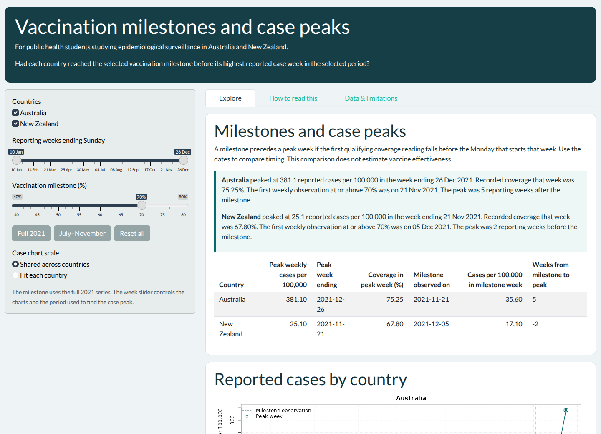

# Rollout Compare

[](https://github.com/ETC5523-2026/etc5523-assignment-4-aarushi611/actions/workflows/R-CMD-check.yaml)

Rollout Compare helps public health students explore how COVID-19 vaccination
coverage and reported cases changed in Australia and New Zealand during 2021.



## Intended user

A public health student comparing national vaccination rollouts in a class on
epidemiological surveillance.

## Question

Had Australia and New Zealand reached a chosen vaccination milestone before
their highest reported case weeks in the selected period?

## Install and launch

```r
install.packages("remotes")
remotes::install_github("ETC5523-2026/etc5523-assignment-4-aarushi611")
library(rolloutcompare)
run_app()
```

[Package documentation and vignette](https://etc5523-2026.github.io/etc5523-assignment-4-aarushi611/)

Choose countries, a range of reporting weeks and a coverage threshold. The app
compares the first weekly milestone observation in the full series with each
country's peak case week in the selected period. Use a shared case scale to compare
peak sizes or country-specific scales to inspect the shape of each trend. Clear
both countries to see the empty-selection message.

## Data and interpretation

The 102 country-week records come from the [Our World in Data COVID-19 archive](https://github.com/owid/covid-19-data/tree/master/public/data).
The archive uses WHO case data and vaccination data collated from official
sources. OWID-produced data are distributed under Creative Commons Attribution.
Third-party inputs remain subject to the original providers' terms.
Vaccination data citation: [Mathieu et al. (2021)](https://doi.org/10.1038/s41562-021-01122-8).
The package code is MIT licensed.

From the repository root, run `Rscript data-raw/prepare.R` to regenerate
the package data, or pass a local copy of the archive CSV as the first argument.
The script filters the two countries to complete weeks in 2021. It converts
weekly reported cases to rates per 100,000 residents and keeps the latest
vaccination observation within each week. Coverage is the share of the total
population that completed the initial vaccine protocol. Blank source values
remain missing. Testing and reporting affect measured case rates, and timing
alone cannot establish a causal effect of vaccination.

The table gives the signed number of reporting weeks from milestone to peak.
Use **Full 2021** or **July–November** to change the reporting window and
**Reset all** to restore the default controls. See
[Methods and data preparation](https://etc5523-2026.github.io/etc5523-assignment-4-aarushi611/articles/methods.html)
for the calculation and validation steps.

## Generative AI declaration

- **ChatGPT:** Helped scope the question, draft and revise the R package, Shiny
  app, data-preparation script, tests, documentation, and workflows. Helped
  debug the code and run local checks.
- **Claude:** Reviewed the submission against the rubric and suggested improvements.

I checked and revised the AI-assisted output against the assignment requirements,
the source data, and the package and app checks.
