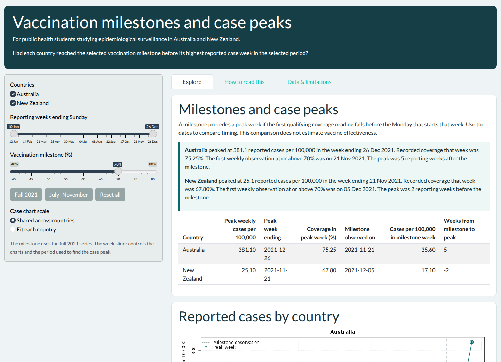

The explorer is for public health students asking how vaccine coverage and
weekly reported COVID-19 case rates changed in Australia and New Zealand in 2021.

## Install and open

```{r, eval=FALSE}
install.packages("remotes")
remotes::install_github("ETC5523-2026/etc5523-assignment-4-aarushi611")
library(rolloutcompare)
run_app()
```



## Try a milestone comparison

1. Keep both countries selected and leave the week range at its full extent.
2. Set the milestone to 70%. Read each country's finding above the table. A
   milestone is before the peak only if its observation date precedes the
   Monday that starts the peak reporting week.
3. Change the milestone to 50%. The case peaks stay fixed because the date range
   has not changed. The milestone dates and case rates at those milestones update.
4. Switch from **Shared across countries** to **Fit each country**. The shared
   scale lets you compare peak heights. The fitted scales make each curve easier
   to read. Check the axis labels before comparing heights.
5. Clear both countries to see the selection prompt.

## Field dictionary

| Field | Meaning |
|---|---|
| Week ending | Sunday at the end of a complete Monday-to-Sunday week. |
| Weekly cases per 100,000 | Reported cases in the week divided by population and multiplied by 100,000. |
| Coverage | Percentage of all residents who completed the initial vaccination protocol. The latest observed value within each week is used. |
| Milestone observed on | Date of the first weekly coverage observation at or above the chosen threshold. The app searches the full available 2021 series. |
| Peak week ending | Sunday of the highest case-rate week within the selected range. Ties use the earliest week. |
| Cases in milestone week | Case rate for the reporting week containing the milestone observation. |
| Coverage in peak week | Last available coverage reading in the selected peak week. |

## Worked example

```{r}
library(rolloutcompare)
result <- summarise_rollout(rollout_weeks, milestone = 70)
knitr::kable(result[, c("Country", "Peak week ending",
                        "Peak weekly cases per 100,000", "Milestone observed on")])
```

```{r, fig.alt="Reported weekly case rates for Australia and New Zealand on a shared scale"}
au <- subset(rollout_weeks, country == "Australia")
nz <- subset(rollout_weeks, country == "New Zealand")
plot(au$week_end, au$cases_per_100k, type = "l", col = "#076b6d", lwd = 2,
     xlab = "Week ending", ylab = "Reported cases per 100,000")
lines(nz$week_end, nz$cases_per_100k, col = "#9c4724", lwd = 2)
legend("topleft", c("Australia", "New Zealand"), lty = 1, lwd = 2,
       col = c("#076b6d", "#9c4724"), bty = "n")
```

Australia's late-December peak dominates the shared case axis. In the app,
fitting each country's scale reveals the timing of changes within New Zealand.
Use the table for exact rates and dates.

## Interpreting the outputs

At 70% and with all available weeks selected, the comparison is:

```{r, echo=FALSE}
knitr::kable(result[, c("Country", "Milestone observed on", "Peak week ending",
                        "Weeks from milestone to peak")])
```

The dashed lines mark milestone observations and the rings mark case peaks.
A positive interval means the peak was in a later reporting week. A negative
interval means the peak was earlier. The coverage chart also rings the reading
from the peak case week when that reading is available. Use **July–November**
to focus on the Delta-era period. This recalculates the case peaks while
retaining the full-series milestone dates. **Full 2021** restores the full window.
**Reset all** restores the countries, window, 70% threshold, and shared scale.

## Limitations

- Only complete reporting weeks within 2021 are included. Australia's full-range
  peak is in the last included week, so later increases would be outside the
  series.
- A milestone date is the first qualifying observation in the weekly series.
  Actual coverage may have crossed the threshold earlier.
- Missing observations stay missing. An unavailable milestone means no weekly
  observation in the series met the selected threshold.
- Testing and reporting practices influence the case curves. The order of
  milestones and case peaks cannot establish vaccine effectiveness.
